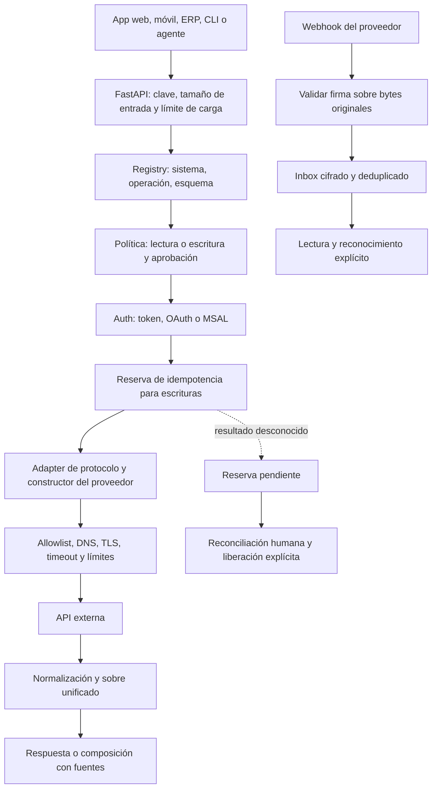

# Arquitectura y recorrido del código

## Diseño

Separamos el contrato del cliente, la autorización, el protocolo y las particularidades del proveedor. REST es un transporte; Gmail o WhatsApp son contratos y políticas sobre ese transporte. No se los trata como equivalentes.

## Componentes

| Archivo | Responsabilidad y límites |
|---|---|
| `config.py` | Variables de proceso y `.env`. No carga todos los secretos para iniciar. |
| `registry.py` | Lectura YAML, expansión diferida de entorno, catálogo sin secretos, detección de duplicados, errores tipados y recarga en caliente. |
| `models.py` | Contrato HTTP, máximos de batch, alias únicos y sobre de éxito/error. |
| `orchestrator.py` | Política, validación de esquema, concurrencia, auth, idempotencia y registro del resultado. |
| `auth.py` | Bearer, API key, Basic, refresh OAuth, client credentials y caché delegada MSAL. |
| `transport.py` | Pool HTTP compartido del proceso con verificación de red, stream limitado, timeout acotado por operación, sin redirects ni retry de escrituras. |
| `security.py` | Allowlist, bloqueo de IPs privadas/reservadas y control de cabeceras. |
| `adapters/` | REST, GraphQL, JSON-RPC, SOAP, proveedor específico y gRPC opcional. |
| `connectors/builders.py` | Traduce los parámetros normalizados al contrato HTTP de cada operación. |
| `connectors/mail_content.py` | MIME Gmail a texto, metadatos y referencias a adjuntos; no carga contenido activo. |
| `normalizer.py` | Selección de campos mediante JMESPath, sin ejecutar código del cliente. |
| `store.py` | Tokens, reservas idempotentes e inbox con valores cifrados en SQLite (WAL), inspección y liberación de pendientes, purga y recuentos. |
| `webhooks.py` | Challenge, validación de firma, extracción y deduplicación de eventos. |
| `response_engine.py` | Composición determinista o modelo opcional, solo lectura, con fuentes y fallos visibles. |
| `ratelimit.py` | Token bucket en memoria por identidad de llamada, con desalojo acotado del diccionario. |
| `cli.py` | Configuración local, consentimiento, consultas, reconocimiento de eventos, reconciliación, recarga y purga. |

## Recorrido de una consulta de Gmail

El cliente pide `gmail/get_message`. El schema valida el ID; el registry comprueba que Gmail está habilitado. Auth recupera el access token cifrado o lo refresca. El adapter codifica el ID en la ruta y pide Gmail API usando HTTPS y host permitido. El resultado conserva su estructura y agrega `_content` cuando hay MIME. El normalizador opcional selecciona campos. El sobre incluye `trace_id` y sensibilidad. `ask` puede componerlo, pero no tiene permiso para enviar.

## Recorrido de una escritura

La política se aplica antes del transporte. Tras obtener credenciales, el store reserva una clave con la huella del contenido y guarda cifrado qué sistema y operación se intentaron. Una repetición completada retorna caché; un conflicto o estado ambiguo no reenvía. El proveedor recibe un único intento HTTP. El resultado aceptado se persiste cifrado y no se confunde con un recibo de entrega. Si falla después de reservar, la respuesta trae `requires_reconciliation` y `reservation_id`, y la reserva queda inspeccionable en `/v1/reconciliation` hasta que alguien declare el resultado comprobado. Nada se libera ni se reintenta de forma automática: ver [RECONCILIATION](RECONCILIATION.md).

## Eventos entrantes

El servidor verifica la firma antes de deserializar y guardar. WhatsApp puede traer varios mensajes y estados dentro de un solo envelope: se extraen individualmente y se deduplican. El inbox no es una cola distribuida ni un motor de auto-respuesta. Un consumidor autorizado lee y reconoce; debe implementar su política de negocio fuera del handler rápido.

## Protocolos originales

REST permite JSON, query y form; GraphQL usa query/variables; JSON-RPC valida el envelope; SOAP interpola valores escapados y analiza con parser defensivo; gRPC es unary binario genérico con TLS por defecto. Un servicio protobuf real requiere stubs/esquemas específicos. No hay implementación universal de todos los tipos RPC o streaming.

## Límites de escala

El diseño actual utiliza un proceso, locks en memoria, un pool HTTP propio, un contador de carga propio y SQLite local. El límite de peticiones y los locks de OAuth no se comparten entre réplicas: con varios workers cada uno cuenta por su cuenta, aunque compartan el archivo de estado. No se prometen disponibilidad alta, separación entre clientes ni coordinación entre workers. La evolución distribuida requiere un store transaccional compartido, cola durable, leases, políticas de identidad, límites por proveedor y reconciliación. Consulte [ROADMAP](../ROADMAP.md).
