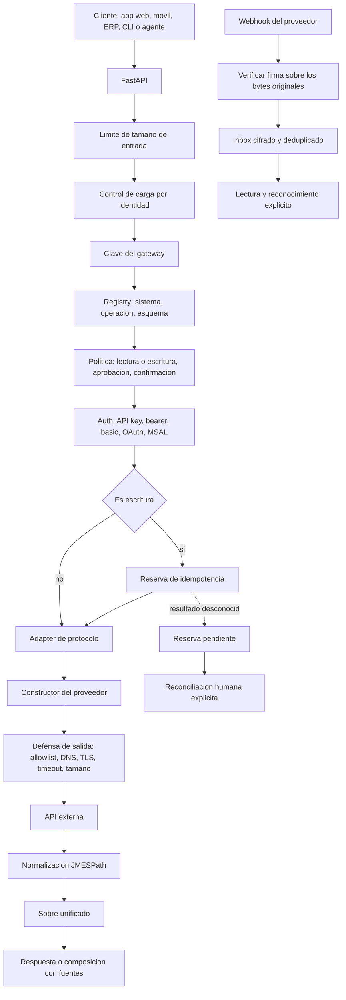

# 03 · Arquitectura

## Idea central

El proyecto separa cuatro cosas que suelen mezclarse: **el contrato del cliente**, **la autorización**, **el protocolo de transporte** y **las particularidades del proveedor**. REST es un transporte; Gmail es un contrato y un conjunto de políticas sobre ese transporte. Tratarlos como equivalentes es el error que produce un cliente distinto por API.

## Capas

| Capa | Archivos | Responsabilidad |
|---|---|---|
| Borde HTTP | `main.py` | Tamaño de entrada, control de carga, identidad de petición, cabeceras de seguridad, autenticación y rutas. |
| Contrato | `models.py` | Forma de la petición y de la respuesta, máximos de batch, alias únicos. |
| Catálogo | `registry.py`, `config/systems.yaml` | Qué sistemas y operaciones existen, con qué esquema y qué efecto. |
| Política | `orchestrator.py` | Valida, decide si puede escribir, limita concurrencia, reserva idempotencia y arma el sobre. |
| Autorización | `auth.py` | Obtiene y refresca credenciales de proveedor. |
| Transporte | `transport.py`, `adapters/` | Habla HTTP (o gRPC) con límites y sin sorpresas. |
| Proveedor | `connectors/` | Traduce parámetros al contrato concreto de cada servicio. |
| Defensa de salida | `security.py` | Allowlist, TLS, bloqueo de red privada, filtrado de cabeceras. |
| Estado | `store.py` | Tokens, reservas e inbox cifrados. |
| Entrada de eventos | `webhooks.py` | Verifica, extrae y deduplica. |
| Composición | `response_engine.py`, `normalizer.py` | Selecciona campos y compone respuestas con fuentes. |
| Operación | `ratelimit.py`, `cli.py` | Control de carga y herramienta local. |

## Decisiones y su motivo

### Catálogo declarativo en YAML

Añadir una operación REST no requiere código: se declara método, ruta, esquema de parámetros, efecto y mapa de respuesta. Lo que **sí** requiere código son los contratos con forma propia (MIME de Gmail, envelope de WhatsApp, adjuntos de Graph), y para eso existen los constructores.

El catálogo es **confiable**: lo administra el operador y una petición externa no puede modificarlo. Por eso el efecto declarado se acepta sin discusión, y por eso la expansión de variables de entorno ocurre allí y no en la entrada del cliente.

### La política va antes del transporte, y antes de las credenciales

En `orchestrator.execute` el orden es: resolver el sistema, validar el esquema, calcular el efecto, filtrar cabeceras, **evaluar la política**, obtener credenciales, reservar idempotencia y ejecutar. Una escritura sin aprobación se rechaza antes de tocar un token y antes de abrir una conexión.

Hay un detalle deliberado en ese orden: las credenciales se obtienen **antes** de reservar la clave de idempotencia. Si faltara el token, reservar primero dejaría una clave bloqueada por un error que no tiene nada que ver con el envío.

### Un sobre único con dos niveles de estado

Toda operación devuelve `UnifiedResponse`. El HTTP del gateway y el `ok` de la operación son independientes: un batch de tres operaciones con una fallida devuelve HTTP 200 y un `ok:false` dentro. Un cliente que solo mire el código HTTP se equivocará, y la documentación lo repite en cada capítulo que toca el tema.

### Idempotencia que bloquea en lugar de adivinar

La reserva guarda la huella SHA-256 del contenido. Misma clave y mismo contenido devuelve el resultado guardado; misma clave con otro contenido da conflicto; una reserva cuyo resultado no se conoce bloquea el reintento. Un gateway que reintenta solo es cómodo hasta el día que duplica algo que importa. El cierre es humano: [capítulo 08](08-data-flow.md) y [RECONCILIATION](../RECONCILIATION.md).

### Defensa de salida en el borde correcto

`assert_safe_endpoint` se ejecuta antes de cada petición, en un hilo aparte para no bloquear el bucle de eventos con la resolución DNS. Comprueba esquema, allowlist, TLS y que ninguna dirección resuelta sea no global. El propio código documenta su límite: entre la comprobación y la conexión hay una ventana, así que **no es una defensa SSRF absoluta** y requiere un firewall de egreso como complemento.

### Pool HTTP compartido

Un `AsyncClient` por petición significaba un handshake TLS por operación. Desde 0.3.0 el cliente es único por proceso, con límites configurables, y se cierra en el apagado. El `timeout` sigue siendo por petición, de modo que una operación puede declarar el suyo sin afectar a las demás.

### Errores públicos estables

`IntegrationError` lleva un código corto y, cuando corresponde, un estado. Nunca contiene URL con token, cuerpo del proveedor ni cabeceras. El cliente puede programar contra esos códigos porque son parte del contrato, y el detalle para investigar se obtiene cruzando `trace_id` con el registro del proveedor.

## Lo que esta arquitectura no resuelve

- **Varias instancias.** SQLite local, locks en memoria y un contador de carga propio. Dos réplicas no coordinan nada salvo lo que esté en el archivo compartido.
- **Varios clientes o empresas.** Las claves son globales del proceso. No hay identidad por usuario, ni autorización por recurso, ni atribución de una aprobación a una persona.
- **Orquestación con dependencias.** `batch` ejecuta operaciones independientes; no es un grafo ni una transacción, y un fallo no deshace lo ya escrito.
- **Entrega garantizada.** Se distingue aceptación de entrega, y no se promete lo segundo.

La evolución de cada punto está en el [capítulo 15](15-risks-and-technical-debt.md) y en el [ROADMAP](../../ROADMAP.md).

## Fuentes de este capítulo

`src/universal_api_orchestrator/main.py`, `orchestrator.py`, `registry.py`, `transport.py`, `security.py`, `store.py`, `adapters/`, `connectors/`, `docs/ARCHITECTURE.md`.
