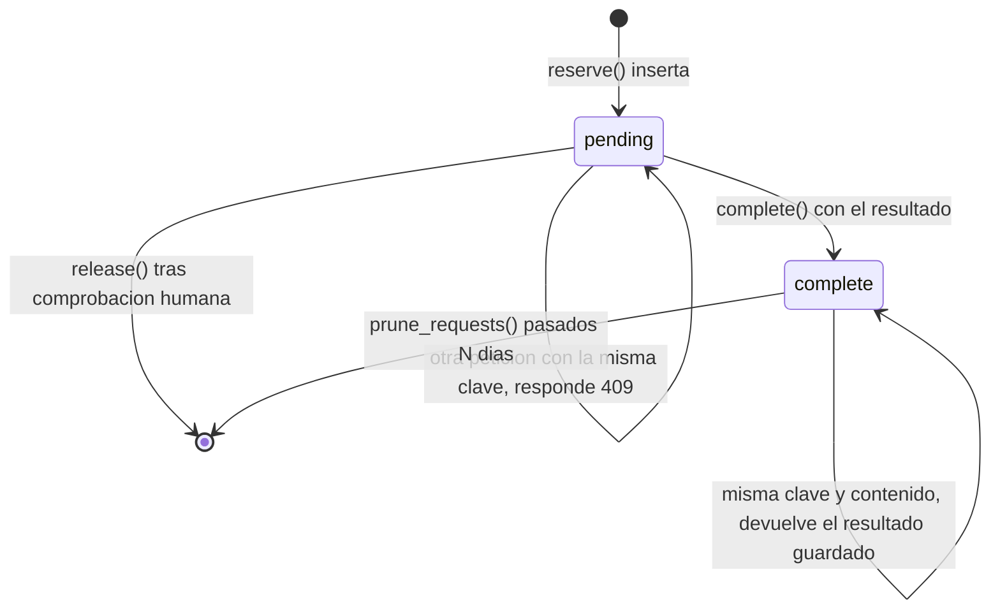

# 07 · Base de datos

## Qué es y qué no es

Un archivo SQLite local, por defecto `data/state.sqlite3`, con tres tablas. **No** es un almacén de mensajes ni un historial de conversaciones: guarda credenciales, reservas de idempotencia y eventos entrantes pendientes de procesar. El contenido de los correos y mensajes que consulte **no se persiste**: viaja en la respuesta y desaparece.

Tampoco es una base compartida. Un proceso, un archivo. Dos réplicas que monten el mismo archivo comparten las reservas, pero no los locks de refresco OAuth ni el contador de carga, que viven en memoria.

## Esquema

```sql
CREATE TABLE IF NOT EXISTS tokens (
    name TEXT PRIMARY KEY,
    payload BLOB NOT NULL);

CREATE TABLE IF NOT EXISTS requests (
    key TEXT PRIMARY KEY,
    fingerprint TEXT NOT NULL,
    status TEXT NOT NULL,
    payload BLOB,
    created REAL NOT NULL);

CREATE TABLE IF NOT EXISTS events (
    id INTEGER PRIMARY KEY AUTOINCREMENT,
    source TEXT NOT NULL,
    event_key TEXT NOT NULL,
    payload BLOB NOT NULL,
    created REAL NOT NULL,
    acked INTEGER NOT NULL DEFAULT 0,
    UNIQUE(source, event_key));

CREATE INDEX IF NOT EXISTS events_pending ON events(acked, id);
CREATE INDEX IF NOT EXISTS requests_status ON requests(status, created);
```

Todo `IF NOT EXISTS`: el esquema se aplica al abrir y es idempotente. No hay sistema de migraciones porque no ha habido cambios incompatibles; de 0.2 a 0.3 solo se añadieron los dos índices y contenido a un `payload` que ya existía.

## Qué está cifrado y qué no

Cada `payload` es un token Fernet: cifrado autenticado con la `STATE_KEY`. Un archivo robado sin esa clave no revela tokens, reservas ni eventos, y una modificación del blob se detecta al descifrar.

**En claro quedan las columnas de control:** `name` del token (`google`, `microsoft`), `key` y `fingerprint` de la reserva (ambos SHA-256), `status`, `source` del evento (`whatsapp`, `github`), `event_key` y las marcas de tiempo. Eso es información de metadatos: quién y cuándo, no qué. Está declarado así en [SECURITY](../SECURITY.md) y es una decisión, no un olvido: esas columnas se usan en índices y en claves únicas, y cifrarlas impediría deduplicar y buscar.

## Tabla `tokens`

| Columna | Contenido |
|---|---|
| `name` | Ranura lógica: el `token_key` del catálogo o del comando de consentimiento. |
| `payload` | Cifrado. Para Google, el JSON de credenciales con `access_token`, `refresh_token`, `client_id`, `expires_at`. Para Microsoft, `{"cache": "<caché MSAL serializada>"}`. |

Ciclo de vida: la escribe `uao auth-google` o `uao auth-microsoft`; la lee y actualiza `auth.oauth()` al refrescar; `_microsoft_sync` la reescribe solo si MSAL dice que la caché cambió. **Nada la borra automáticamente.** Para eliminar un consentimiento, borre el estado y revoque además en el proveedor: lo segundo no lo hace esta base.

`INSERT OR REPLACE` significa que volver a autorizar la misma ranura sobrescribe lo anterior. Es lo que se quiere al renovar un consentimiento, y es un detalle a tener en cuenta si usa la misma ranura para dos cuentas: la segunda gana.

## Tabla `requests`

El corazón de la idempotencia.

| Columna | Contenido |
|---|---|
| `key` | SHA-256 de `sistema:idempotency_key`. Es también el `reservation_id` que ve el operador. |
| `fingerprint` | SHA-256 del JSON ordenado de `{system, operation, params, headers}`. |
| `status` | `pending` o `complete`. |
| `payload` | Cifrado. Mientras está pendiente, `{"attempt": {...}}` con sistema, operación, parámetros y cabeceras. Al completarse, el `UnifiedResponse` serializado. |
| `created` | Momento de la reserva, no de la finalización. |

### Transiciones



Lo que **no** existe en ese diagrama: una transición automática de `pending` a cualquier otro estado. Una reserva en duda solo sale por decisión humana (`release`) o quedándose ahí. No hay temporizador, no hay caducidad y no hay reintento.

### Por qué `created` es el momento de la reserva

Porque es el dato que el operador necesita: `age_seconds` en `uao pending` dice cuánto lleva esa escritura sin resolverse. Si fuera el momento de la finalización, la antigüedad de lo pendiente sería siempre cero.

También explica un detalle de `prune_requests`: filtra por `created` y `status='complete'`, de modo que una reserva antigua que se completó se expira, y una antigua que sigue pendiente **no**.

## Tabla `events`

| Columna | Contenido |
|---|---|
| `id` | Autoincremental; es el cursor de `GET /v1/events?after=`. |
| `source` | Nombre del sistema que recibió el webhook. |
| `event_key` | Clave de deduplicación, calculada por proveedor. |
| `payload` | Cifrado: el evento extraído, no el envelope completo. |
| `created` | Recepción. |
| `acked` | 0 o 1. Reconocimiento **local**. |

`UNIQUE(source, event_key)` con `INSERT OR IGNORE` es toda la deduplicación: si la fila ya existe, `rowcount` es 0 y la respuesta del webhook lo informa como duplicado. El proveedor puede reenviar el mismo evento cuantas veces quiera.

Claves de deduplicación por proveedor:

| Proveedor | Clave |
|---|---|
| Meta / WhatsApp | `message:<id>` para mensajes; `status:<id>:<estado>:<timestamp>` para estados |
| Telegram | `update_id` |
| Slack | `event_id` |
| GitHub | `X-GitHub-Delivery` **más** el SHA-256 del cuerpo firmado |

El caso de GitHub es deliberado: una cabecera no firmada no debe ser la única identidad de un evento. Para los demás, si falta el identificador propio se usa el hash del cuerpo como respaldo.

`acked=1` significa que un consumidor dijo haberlo procesado. No se envía nada al proveedor, y el gateway no actúa sobre los eventos: no hay respuesta automática.

## Conexiones y concurrencia

```python
db = sqlite3.connect(self.path, timeout=15)
db.execute("PRAGMA journal_mode=WAL")
db.execute("PRAGMA synchronous=NORMAL")
db.execute("PRAGMA busy_timeout=15000")
```

Una conexión por operación, abierta y cerrada en un gestor de contexto. Para el volumen de este servicio es más simple y seguro que un pool, y evita compartir una conexión entre corrutinas.

- **WAL**: lectores y un escritor no se bloquean entre sí. Antes de 0.3.0, leer el inbox podía esperar a que terminara una reserva. Crea dos archivos auxiliares, `-wal` y `-shm`, junto a la base: hay que **copiarlos también** en un respaldo en caliente, o detener el proceso antes de copiar.
- **`synchronous=NORMAL`**: con WAL es seguro ante caída del proceso; ante caída del sistema operativo podría perderse la última transacción. Para un inbox y unas reservas es un intercambio razonable, y está declarado.
- **`busy_timeout` de 15 s**: dos procesos sobre el mismo archivo esperan en lugar de fallar al instante.

`BEGIN IMMEDIATE` solo se usa en `reserve()`, donde la condición de carrera es real y el precio de equivocarse es un mensaje duplicado.

## Permisos del archivo

`Store.__init__` hace `os.chmod(path, 0o600)` en sistemas POSIX. En Windows no se aplica: `os.chmod` no tiene el mismo significado, y la protección correcta son los permisos NTFS de la carpeta. En contenedor, el archivo pertenece al usuario 10001 y el problema habitual es el desajuste de UID con el host.

## Tamaño y crecimiento

| Tabla | Crece con | Se controla con |
|---|---|---|
| `tokens` | El número de ranuras autorizadas: unidades. | Nada; es pequeña por naturaleza. |
| `requests` | Cada escritura ejecutada. | `uao prune-requests --days N` (solo completadas). |
| `events` | Cada evento recibido. | `uao prune-events --days N` (solo reconocidos). |

Ninguna purga es automática. Es una decisión: borrar solo una fila pendiente o un evento sin reconocer perdería exactamente la información que hace falta. `uao stats` da los cinco recuentos para vigilarlo.

SQLite no devuelve espacio al sistema al borrar filas; si el archivo creció mucho, un `VACUUM` con el proceso detenido lo compacta. No se hace automáticamente porque bloquea la base.

## Respaldo y recuperación

Detenga el proceso y copie `data/` **junto con** la `STATE_KEY`, guardándolas en sitios distintos: el archivo sin la clave es ilegible y la clave sin el archivo no sirve. Si copia en caliente, incluya `-wal` y `-shm`.

Perder la `STATE_KEY` con la base intacta significa: repetir el consentimiento de cada proveedor (los tokens son ilegibles) y reconciliar a mano las reservas que estuvieran en duda. `pending()` lo detecta y marca `decode_warning: UNREADABLE_WITH_CURRENT_STATE_KEY` en lugar de fallar, para que el operador vea qué filas existen aunque no pueda leerlas.

`bootstrap.py` se niega a generar una `STATE_KEY` nueva si ya hay una base de datos, precisamente para que ese error no ocurra por descuido.

## Consultar la base a mano

Es posible, con cuidado: abra una **copia**, nunca el archivo en uso. Las columnas de control son legibles en claro; los `payload` requieren la clave:

```python
from cryptography.fernet import Fernet
import json, sqlite3
cipher = Fernet(open(".state-key").read().strip().encode())
db = sqlite3.connect("copia-state.sqlite3")
for row in db.execute("SELECT key, status, created FROM requests WHERE status!='complete'"):
    print(row)
```

Modificar la base a mano para "desbloquear" una reserva es la forma de perder la protección contra duplicados. Use `uao release`, que exige comprobar y declarar el resultado.

## Fuentes de este capítulo

`src/universal_api_orchestrator/store.py` completo, `webhooks.py` (`extract_events`), `auth.py` (uso de `tokens`), `cli.py` (comandos de purga), `scripts/bootstrap.py` y `tests/test_storage_auth.py`, `tests/test_reconciliation.py`.
