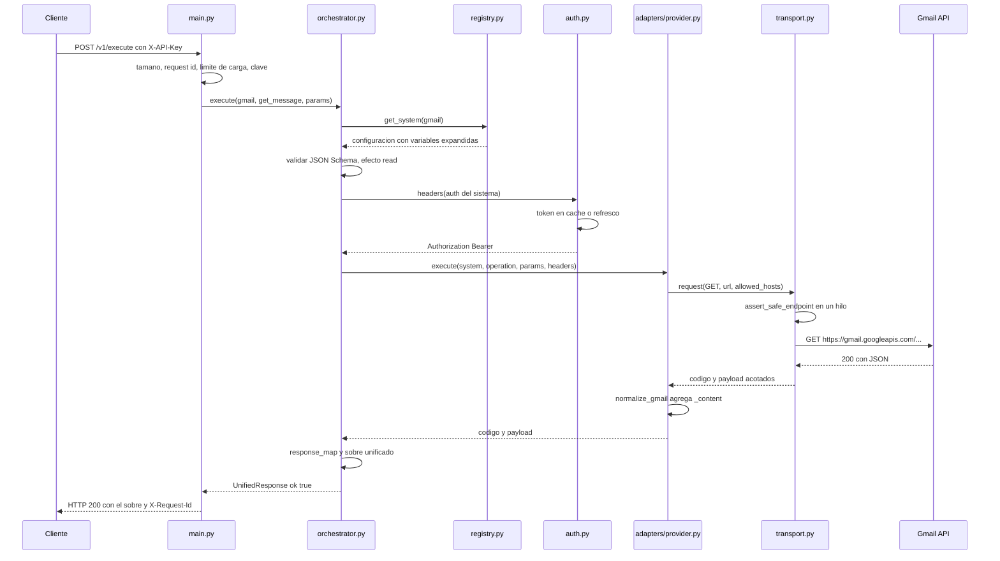
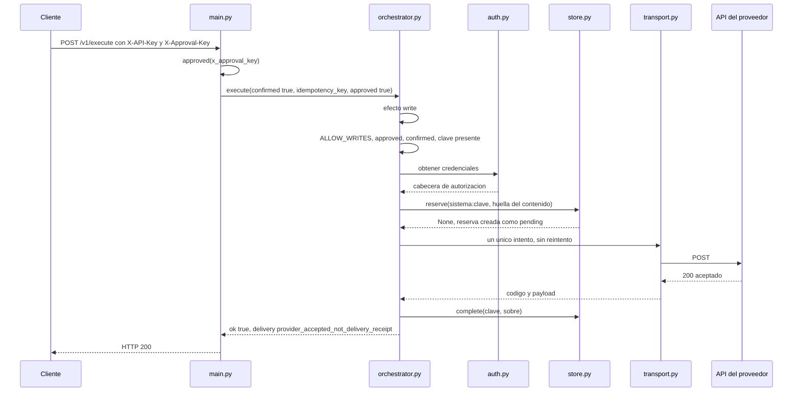
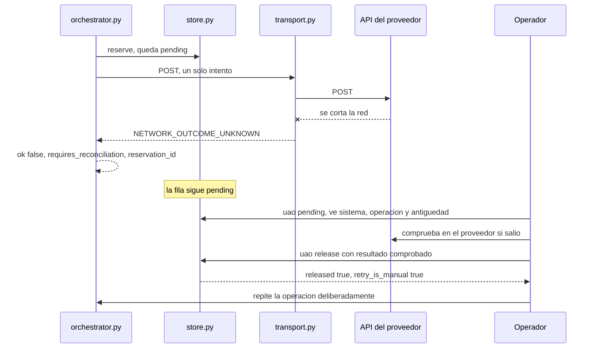
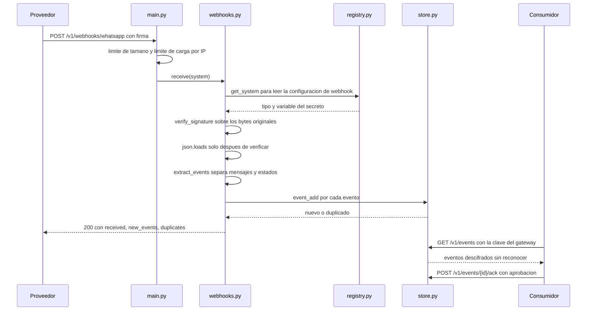

# 08 · Flujo de datos

Cuatro recorridos completos, paso a paso: una consulta, una escritura, una escritura que falla y un evento entrante. Cada paso dice qué archivo lo ejecuta.

## 1. Una consulta de Gmail



Qué viaja en cada tramo:

| Tramo | Contiene | No contiene |
|---|---|---|
| Cliente → gateway | sistema, operación, parámetros, clave del gateway | ningún token de proveedor |
| Gateway → Gmail | `Authorization` resuelto en el backend, ruta con el identificador codificado | la clave del gateway, cabeceras del cliente no declaradas |
| Gmail → gateway | JSON del proveedor, cortado si supera 4 MB | — |
| Gateway → cliente | sobre unificado con `data`, `_content` y `meta` | credenciales, URL internas, cabeceras del proveedor |

El token nunca sale hacia el cliente y la clave del gateway nunca sale hacia el proveedor. Es la razón de ser del intermediario.

## 2. Una escritura aprobada



Las cuatro condiciones se comprueban en una sola expresión:

```python
if not settings.allow_writes or not approved or not confirmed:
    raise IntegrationError("WRITE_APPROVAL_REQUIRED", 403)
if not idempotency_key:
    raise IntegrationError("IDEMPOTENCY_KEY_REQUIRED", 400)
```

El mensaje de error es el mismo para las tres primeras, a propósito: no se informa a un cliente **cuál** de las condiciones falta.

Una repetición con la misma clave y el mismo contenido no vuelve a salir: `reserve()` devuelve el sobre guardado y se marca `idempotent_replay: true`. Con otro contenido, `IDEMPOTENCY_CONFLICT`.

El campo `delivery` dice `provider_accepted_not_delivery_receipt`. Esa cadena es el resumen de una política: el proveedor aceptó la petición, y eso no es lo mismo que el destinatario lo haya recibido.

## 3. Una escritura cuyo resultado se desconoce



El punto crítico es el `--x`: el gateway envió la petición y no leyó la respuesta. No sabe si el mensaje salió. Las tres opciones serían reintentar (riesgo de duplicado), descartar (riesgo de no enviar nunca) o bloquear y preguntar. Elige la tercera.

Mientras la fila sigue `pending`, cualquier petición con esa clave responde `OUTCOME_PENDING_OR_UNKNOWN_RECONCILE` con 409. El procedimiento completo está en [RECONCILIATION](../RECONCILIATION.md).

## 4. Un evento entrante



Tres propiedades de este flujo:

1. **La firma se verifica antes de deserializar.** Entrada no autenticada no llega al parser de JSON.
2. **El gateway no responde al proveedor nada más que un acuse HTTP.** No hay respuesta automática al remitente, no hay reenvío, no hay lógica de negocio en el handler.
3. **Reconocer es local.** `ack` marca la fila; el proveedor no se entera. Si su consumidor falla después de leer y antes de reconocer, el evento sigue disponible: es entrega al menos una vez, y su consumidor debe ser idempotente.

El challenge `GET` existe solo para Meta y exige que el `hub.verify_token` coincida con la variable configurada, comparado con `compare_digest`.

## Dónde está cada dato, en qué momento

| Dato | En tránsito | En reposo | Durante cuánto |
|---|---|---|---|
| Clave del gateway | cabecera del cliente | `.env` del servidor | vida de la instalación |
| Clave de aprobación | cabecera del cliente | `.env` | ídem |
| Token de proveedor | cabecera hacia el proveedor | tabla `tokens`, cifrado | hasta revocar o reautorizar |
| Contenido de un correo | respuesta del proveedor y del gateway | **en ninguna parte** | solo en memoria durante la petición |
| Parámetros de una escritura | petición del cliente | tabla `requests`, cifrado, hasta completarse o purgarse | según retención |
| Resultado de una escritura | respuesta | tabla `requests`, cifrado | hasta `prune-requests` |
| Evento entrante | cuerpo del webhook | tabla `events`, cifrado | hasta `ack` y `prune-events` |
| Identidad de carga | — | memoria del proceso, como hash | hasta reiniciar |

La fila que más sorprende es la del contenido: el gateway **no guarda** los mensajes que consulta. Si necesita un archivo histórico, lo construye su aplicación, con sus propias políticas de retención y consentimiento.

## Qué se registra

El registro de auditoría (`uao.audit`) anota una línea por operación con `trace_id`, sistema, operación y, si falló, el código. **No** anota parámetros, cuerpos, URL con token ni cabeceras. Un registro no sirve para reconstruir un mensaje; sirve para localizarlo en el registro del proveedor.

La CLI sí muestra en pantalla los datos que el operador pidió: su terminal y cualquier redirección de salida son parte de la superficie a proteger.

## Fuentes de este capítulo

`src/universal_api_orchestrator/main.py`, `orchestrator.py`, `auth.py`, `transport.py`, `store.py`, `webhooks.py`, `adapters/provider.py`, `connectors/mail_content.py`, y las pruebas `tests/test_orchestrator_api.py`, `tests/test_reconciliation.py`, `tests/test_security_webhooks.py`.
