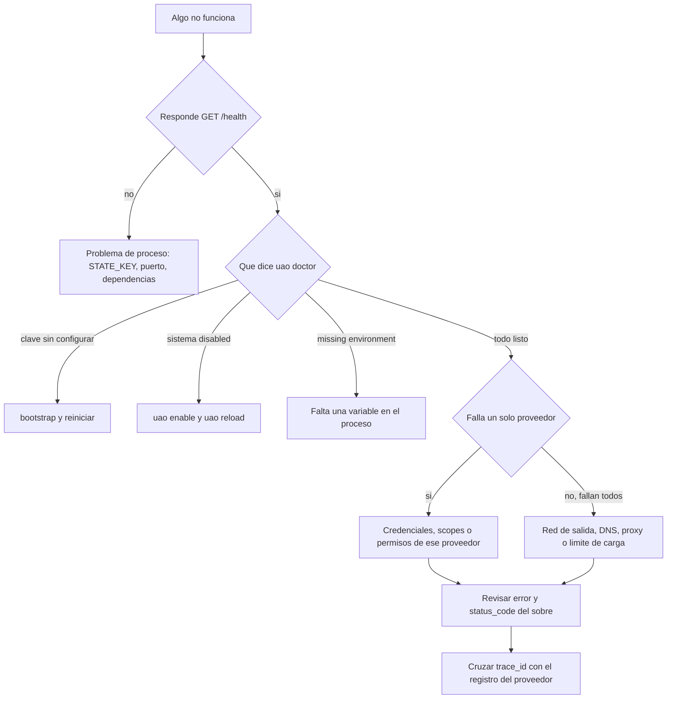

# 14 · Troubleshooting

La tabla rápida de códigos está en [TROUBLESHOOTING](../TROUBLESHOOTING.md). Este capítulo es el **método**: cómo acotar un problema sin cambiar credenciales a ciegas.

## Procedimiento de diagnóstico

Siempre en este orden. Saltarse un paso es la causa habitual de perder una hora.



**Si `/health` falla, no investigue scopes.** **Si falla un solo proveedor, no toque las credenciales de todos.**

Y una advertencia sobre `uao doctor`: no hace autenticación remota. `config_ready_credentials_not_verified` significa que el entorno está completo, no que el consentimiento sea válido.

## Los cuatro malentendidos más frecuentes

### "Responde HTTP 200 pero no funcionó"

Hay dos niveles de estado. El HTTP dice que el gateway procesó la petición; `ok` dice si la operación salió bien. Un batch de tres operaciones con una fallida devuelve 200. **Revise siempre `ok`**, y en la CLI el código de salida 2 significa exactamente eso.

### "Aprobé y no envió"

`--approve` añade la cabecera de aprobación; **no** cambia `confirmed` en el archivo. Son decisiones independientes a propósito: ejecutar un ejemplo por descuido no lo aprueba. Hacen falta las cuatro: `ALLOW_WRITES=true` en el servidor, la cabecera, `confirmed:true` y una `idempotency_key` sin conflicto. El error es el mismo para las tres primeras, así que compruébelas todas.

### "Edité `.env` y nada cambió"

`uao reload` recarga el **catálogo**, no las variables de entorno. `.env` se lee al iniciar el proceso. Reinícielo. En contenedor, editar el archivo del host tampoco afecta a un contenedor en marcha.

### "Habilité el sistema y sigue deshabilitado"

`uao enable` escribe en el YAML; el proceso en marcha sigue con el catálogo que cargó. `uao reload` (o un reinicio) lo aplica.

## Síntomas por área

### El proceso no arranca

| Síntoma | Causa | Acción |
|---|---|---|
| `STATE_KEY requerida` | Falta la clave | `python scripts/bootstrap.py` |
| `Fernet key must be 32 url-safe base64-encoded bytes` | Clave mal copiada | Restaure la original; **no** genere otra si hay base de datos |
| `Existe una base de datos sin STATE_KEY` | Bootstrap protegiendo el estado | Busque la clave original. Generar otra deja el estado ilegible |
| Error de catálogo al arrancar | YAML inválido, sistema duplicado o `operations` que no es un mapa | `python scripts/verify_repository.py` lo señala |
| Puerto ocupado | Otra instancia | Cambie `--port` o detenga la anterior |

### Autenticación del gateway

| Síntoma | Causa |
|---|---|
| 503 en todas las rutas `/v1` | `GATEWAY_API_KEY` ausente o de menos de 24 caracteres |
| 401 `INVALID_API_KEY` | La clave del cliente no coincide. No la confunda con el token del proveedor |
| 403 `APPROVAL_REQUIRED` | Falta `X-Approval-Key` en reconciliación o recarga |

### Credenciales del proveedor

| Código | Qué revisar |
|---|---|
| `MISSING_CREDENTIALS` | La variable no está en el proceso que ejecuta el servidor. Un `.env` editado no llega a un contenedor en marcha |
| `SYSTEM_CONFIGURATION_INCOMPLETE` | El catálogo pide una variable ausente o **vacía**: una cadena vacía cuenta como ausente |
| `OAUTH_CONSENT_REQUIRED` | No hay refresh token en esa ranura. Autorice con `uao auth-google` y el `--token-key` correcto |
| `INVALID_TOKEN_RESPONSE` | El endpoint de token no devolvió `access_token`: credenciales de cliente o scopes |
| `MSAL_CONSENT_REQUIRED` | La caché no tiene un token válido |
| `MSAL_CONSENT_OR_ACCOUNT_SELECTION_REQUIRED` | Ninguna cuenta, o varias sin seleccionar: use `username` en el catálogo |
| `INSTALL_AUTH_EXTRA` | Falta el extra: `pip install -e ".[auth]"` |
| `UPSTREAM_HTTP_401/403` | El token existe pero el proveedor lo rechaza: scopes, permisos de la aplicación o políticas de la cuenta |

Un `401` del proveedor con un token recién obtenido casi siempre es un scope insuficiente, no una credencial incorrecta. `gmail.readonly` no permite enviar.

### Escrituras e idempotencia

| Código | Significado | Acción |
|---|---|---|
| `WRITE_APPROVAL_REQUIRED` | Falta alguna de las tres primeras condiciones | Revise las tres |
| `IDEMPOTENCY_KEY_REQUIRED` | Escritura sin clave | Asigne una clave estable por acción lógica |
| `IDEMPOTENCY_CONFLICT` | Misma clave, otro contenido | Clave nueva para una acción nueva. **No** reutilice |
| `OUTCOME_PENDING_OR_UNKNOWN_RECONCILE` | Reserva en duda | [Reconciliar](../RECONCILIATION.md). No cambie la clave para saltar el bloqueo |
| `NETWORK_OUTCOME_UNKNOWN` | Se perdió la respuesta de un único intento | **No asuma que no se envió.** Compruebe en el proveedor |
| `ASK_IS_READ_ONLY` | Escritura desde `/v1/ask` | Separe composición y envío |

Cambiar la `idempotency_key` para evitar un bloqueo es la forma de enviar un mensaje dos veces. El bloqueo está ahí precisamente para impedirlo.

### Red y defensa de salida

| Código | Causa | Nota |
|---|---|---|
| `HOST_NOT_ALLOWED` | El host no está en `allowed_hosts` | Corrija el catálogo, no el control |
| `TLS_REQUIRED` | URL `http://` sin `ALLOW_PRIVATE_NETWORKS` | Use HTTPS; la excepción es para un endpoint local deliberado |
| `PRIVATE_NETWORK_BLOCKED` | El host resuelve a una dirección no global | Es la defensa SSRF. Si es un servicio interno legítimo, habilítelo a conciencia |
| `DNS_UNRESOLVED` | El host no resuelve | Revise DNS del contenedor o del servidor |
| `UPSTREAM_HTTP_3xx` | El proveedor redirige | No se siguen redirecciones. Corrija la URL base del catálogo |
| `UPSTREAM_RESPONSE_TOO_LARGE` | Más de 4 MB | Use `response_map` o pagine. No desactive el límite |
| `NETWORK_ERROR` | Fallo de red en una lectura reintentada | Conectividad o proveedor caído |

### Límite de carga

`RATE_LIMIT_EXCEEDED` con 429 es **del gateway**; `UPSTREAM_HTTP_429` es **del proveedor**. Los códigos son distintos a propósito.

Si un cliente legítimo lo recibe de forma sostenida: respete `Retry-After`, reparta el tráfico en claves distintas o suba `RATE_LIMIT_PER_MINUTE`. Poner 0 desactiva el control y oculta un bucle del cliente en lugar de arreglarlo.

### Webhooks

| Síntoma | Causa |
|---|---|
| 401 `INVALID_WEBHOOK_SIGNATURE` | Secreto incorrecto, cabecera equivocada, o un proxy que reserializó el cuerpo |
| 401 `INVALID_VERIFICATION_TOKEN` | El `hub.verify_token` del challenge de Meta no coincide |
| 404 `WEBHOOK_NOT_CONFIGURED` | El sistema está deshabilitado o no declara `webhook` |
| 400 `INVALID_EVENT` | El cuerpo no es un objeto JSON interpretable |
| No llega nada en local | El proveedor no alcanza su loopback. Necesita una URL HTTPS pública |
| Llega y se ignora | ¿Hay un consumidor leyendo `/v1/events`? El gateway no actúa sobre los eventos |
| Todo duplicado | Normal: el proveedor reenvía. `duplicates` en la respuesta lo confirma |

El caso del proxy que reserializa es el más difícil de ver: el secreto es correcto y la firma no cuadra. La verificación se hace sobre los bytes exactos recibidos.

### Estado y base de datos

| Síntoma | Causa |
|---|---|
| `Permission denied` en SQLite | UID del contenedor distinto del propietario de `data/`, o ACL en Windows |
| `database is locked` | Otro proceso escribiendo más de 15 segundos. ¿Dos instancias sobre el mismo archivo? |
| `UNREADABLE_WITH_CURRENT_STATE_KEY` | La fila se cifró con otra clave. **Pare** y restaure la original |
| El archivo crece sin parar | Nada se purga solo: `uao prune-events`, `uao prune-requests` |

### Composición y modelo

| Advertencia | Significado |
|---|---|
| `AI_SENSITIVE_DATA_BLOCKED` | La protección funcionando: los 13 proveedores son `sensitive` |
| `AI_MODEL_NOT_CONFIGURED` | Falta `OPENAI_COMPATIBLE_MODEL` |
| `AI_INPUT_TOO_LARGE_USE_RESPONSE_MAP` | Reduzca con `response_map` o baje el alcance |
| `AI_FAILED_DETERMINISTIC_FALLBACK` | El modelo falló; se devolvió la composición determinista |

Si faltan correos en un resumen: el listado devuelve identificadores, no cuerpos; el filtro puede excluirlos; puede haber paginación; o no se consultó el mensaje completo. Use `get_message` y revise `errors` y `sources`. El sistema **no inventa** contenido a partir de un identificador: si no está, es que no se obtuvo.

## Herramientas de diagnóstico

```bash
uao health    # el proceso responde
uao doctor    # claves, política y estado de cada sistema
uao stats     # recuentos: ¿hay reservas pendientes? ¿eventos sin consumir?
uao pending   # qué escrituras quedaron en duda
uao catalog   # qué ve el proceso, no qué dice el archivo
python scripts/verify_repository.py
```

`uao stats` es el más subestimado: un `requests_pending_reconciliation` alto explica muchos comportamientos que parecen "lentitud" o "mensajes que no salen".

## Cómo pedir ayuda

Incluya versión, sistema operativo, versión de Python, comando exacto, respuesta completa con `error`, `status_code` y `meta`, y el `X-Request-Id` o `trace_id`. Antes de pegar nada, **elimine tokens, direcciones reales, números de teléfono y contenidos privados**. El procedimiento está en [SUPPORT](../../SUPPORT.md); si es una vulnerabilidad, en [SECURITY](../../SECURITY.md) y no en una incidencia pública.

## Fuentes de este capítulo

`docs/TROUBLESHOOTING.md`, `src/universal_api_orchestrator/errors.py`, `orchestrator.py`, `transport.py`, `security.py`, `store.py`, `webhooks.py`, `auth.py`, `response_engine.py`, `cli.py`, `scripts/bootstrap.py`.
